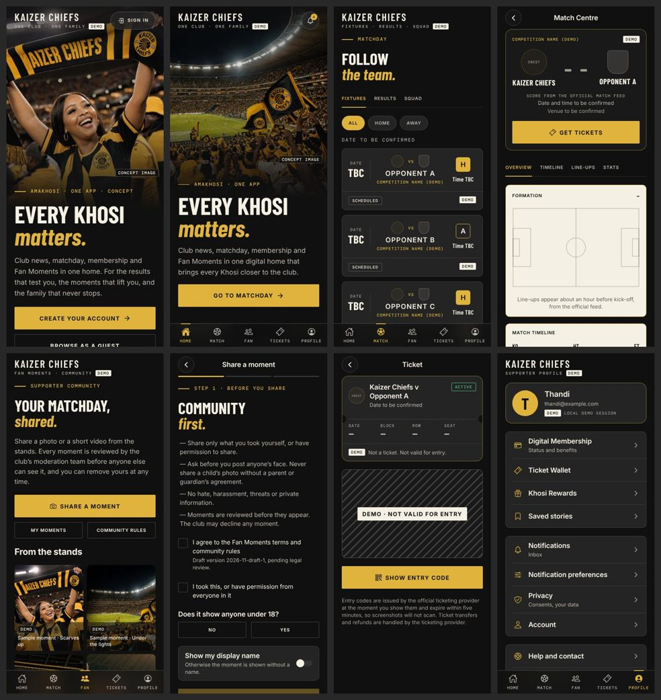
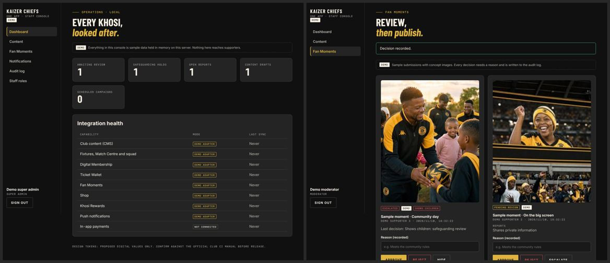

# Kaizer Chiefs One App

**Status: proposed product and visual direction. Not an official Kaizer Chiefs product, and not
approved by the club.** Every piece of content in this build is labelled DEMO or SAMPLE, every
photograph is a labelled CONCEPT IMAGE, and the crest is a reserved placeholder until the club
supplies its approved artwork.

> One club. One family. Every Khosi matters.



## What is here

| Path | What it is |
| --- | --- |
| `apps/mobile` | Expo SDK 57 / React Native app for iOS and Android (and a web preview). 30 routes. |
| `apps/admin` | Next.js 16 staff console: content, moderation, campaigns, audit log, roles. |
| `packages/ui` | Design tokens: colour, type, spacing, radii, elevation, breakpoints, states, springs. |
| `packages/contracts` | zod schemas, domain types, provider interfaces, RBAC and capability flags. |
| `supabase` | Migrations, RLS policies, storage rules, edge function stubs and policy tests. |
| `single-file` | [`Kaizer_Chiefs_One_Concept.html`](single-file/Kaizer_Chiefs_One_Concept.html): the concept app as one self-contained 1.5 MB file that opens offline on Android and iPhone and reads as a WhatsApp document, with parallax. Also published as a private claude.ai Artifact. See its [README](single-file/README.md). |
| `deck` | [`Kaizer_Chiefs_One_App_Marketing_and_Investment_Strategy.pdf`](deck/Kaizer_Chiefs_One_App_Marketing_and_Investment_Strategy.pdf): a 26-slide proposal for the club covering what the app does, how it markets itself, the launch plan, the itemised costing and the payback. See its [README](deck/README.md). |
| `docs` | [Discovery](docs/discovery.md), [architecture](docs/architecture.md), [integration contracts](docs/integration-contracts.md), [security and privacy](docs/security-privacy.md), [brand assets](docs/brand-assets.md), [decisions](docs/decisions.md), [open decisions](docs/open-decisions.md), [release checklist](docs/release-checklist.md). |

## Run it

Requires Node 22. From this folder:

```bash
npm install
npm run mobile          # Expo dev server: press i, a or w
npm run admin           # staff console on http://localhost:3100
```

With no configuration the app runs in **local demo mode**: every feature is served by a demo
adapter that returns labelled sample content. Sign in with any email and password; the form uses
the real validation rules, then starts a local demo session. No account is created anywhere.

The admin's demo sign-in lets you pick a role (super admin, content admin, moderator, support
agent, analyst). Each sees and can do only what its permissions allow.



Configuration names live in [`.env.example`](.env.example). Copy it to `apps/mobile/.env.local`
or `apps/admin/.env.local`. Never put a secret in an `EXPO_PUBLIC_*` variable.

## Checks

| Command | What it does |
| --- | --- |
| `npm run verify` | Typecheck, lint, format check and every test suite (below) |
| `npm test` | Tokens (31), contracts (30), mobile (20), admin (14), RLS policies (37) |
| `npm run build:admin` | Production build of the staff console |
| `npm run export:mobile` | Hermes bundles for iOS and Android |
| `npm run export:web -w @kc-one/mobile && npm run screens` | Renders all 30 routes at 390pt and 320pt; fails on overflow, blank screens or console errors |
| `node apps/admin/scripts/smoke.mjs` | Drives the running admin as four roles (start it first) |

CI runs all of these in `.github/workflows/kc-one.yml` whenever this folder changes.

The RLS tests run the real migrations inside PGlite (Postgres compiled to WebAssembly) with a
small stand-in for Supabase's `auth` schema and roles, so they need no Docker. They prove that
supporters cannot read or change each other's data, that only the right staff roles can moderate,
publish or change roles, that the audit log cannot be edited, and that the SQL permission matrix
and moderation transitions match the TypeScript ones exactly.

## What the demo never does

The brief's accuracy rules are enforced in the shared schemas, so a demo adapter cannot break
them even by mistake:

- no scores, line-ups, match events or statistics without an authorised feed;
- no real-looking fixtures: opponents are "Opponent A", dates and venues are "to be confirmed";
- no player names, likenesses or biographies;
- no verified membership, points balance, partner offer, price or store link;
- no scannable ticket code: the demo ticket shows a hatched "NOT VALID FOR ENTRY" placeholder;
- no pretend success for payments, redemptions, reports or uploads: each says plainly that nothing
  was sent.

Production builds refuse to start with any demo adapter switched on, and in-app payments cannot be
enabled at all until a provider is approved.

## Design

The editorial direction follows the supplied inspiration: a full-bleed photograph falling away into
black, a gold-ruled monospace eyebrow, a two-line headline with the accent line in gold italic, one
honest paragraph and a single flat gold call to action. It is typeset in the brief's proposed system
(Barlow Condensed, Inter and DM Mono; Amakhosi Gold on Deep Black with Warm Ivory reading
surfaces). Motion follows Apple's fluid-interface guidance: press feedback on touch-down, springs that
start from the current value and can be interrupted, a bottom sheet that tracks the finger, projects
momentum and hands off velocity, and Reduce Motion replaced by cross-fades. Photographs sit further back
than the interface: hero photos travel at about a third of the scroll speed and rail photos slide
inside their cards, switched off under Reduce Motion.

All colour and type values are proposals in `packages/ui` and are replaced in one place when the
club's CI manual arrives.
