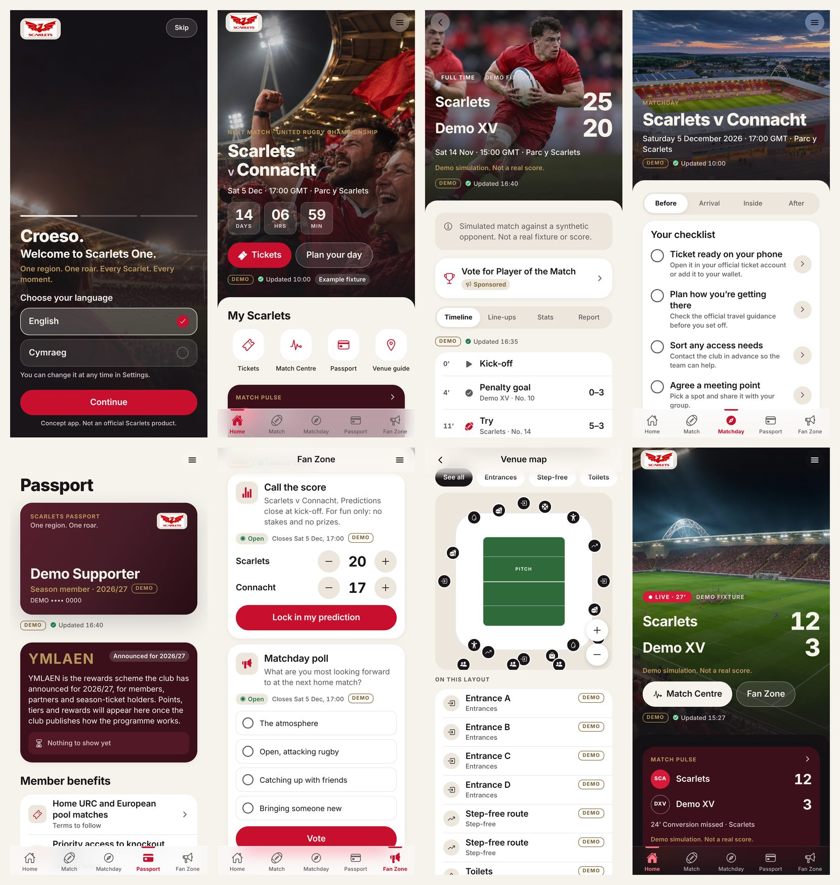

# Scarlets One

A supporter app concept for Scarlets Rugby: one connected experience across
fixtures, Match Centre, matchday planning, ticket journeys, club news,
Passport and YMLAEN, the Fan Zone, partners and help.

**This is a concept. It is not an official Scarlets product.** No ticketing,
membership, rewards, live-data or commerce integration has been granted or
connected. Every fixture, score, reward and venue detail in this build is demo
data and is labelled DEMO where it appears. The 39 supplied images are concept
material until the club confirms rights, accuracy and approval.

Built from `Scarlets_One_Fan_App_Product_and_Claude_Code_Briefing.docx`
(21 November 2026).



## What is in the box

| Path                  | What it is                                                                                                                  |
| --------------------- | --------------------------------------------------------------------------------------------------------------------------- |
| `apps/mobile`         | The supporter app. React Native, Expo SDK 57, Expo Router, TypeScript. Runs on iOS, Android and the web.                    |
| `apps/admin`          | The club operations console. Next.js 16, TypeScript.                                                                        |
| `packages/domain`     | Shared types, schemas and rules: fixtures, match events, content, Passport, Fan Zone, partners, roles, analytics, language. |
| `packages/adapters`   | The provider contracts, mock implementations and labelled demo data.                                                        |
| `packages/api-client` | The `/v1` API contract, the service that composes it, and an HTTP client that validates every reply.                        |
| `packages/ui`         | Design tokens, motion maths and contrast checks.                                                                            |
| `supabase`            | Postgres schema, row-level security, retention, and their tests.                                                            |
| `assets/reference`    | The 39 supplied visuals, app-ready, with a manifest.                                                                        |
| `tests/e2e`           | Browser journeys for the app and the console.                                                                               |
| `docs`                | Design system, integrations, data model.                                                                                    |

## Run it

Needs Node 22.13 or later.

```sh
cd scarlets-one
npm install

npm run mobile          # Expo dev server: press i, a or w
npm run mobile:web      # the app in a browser
npm run admin           # the console at http://localhost:3100
```

The app needs no backend: it runs the API in-process over the mock providers.
Open **More → Demo controls** to move it through a matchday (two weeks out,
matchday morning, live, half-time, full time, no fixture) and to make each
provider run late, go down or lose the network.

## Check it

```sh
npm run verify          # typecheck, lint, format check and every test suite

npm run mobile:export   # static web build of the app
npm run e2e             # supporter journeys in a phone-sized browser

npm run build:admin
npm run e2e:admin       # console roles and audit log in a browser
```

## What has been verified, and what has not

Verified in this repository on 21 November 2026:

- **533 automated tests pass**: domain rules 41, design tokens and motion 61,
  mock providers 37, API contract 24, app 21, console 205, database 144.
- **Supporter journeys, 21 of 21 checks**, in Chromium at iPhone 14 size
  against the exported web build: onboarding, language switch, ticket
  link-out, fixture and Match Centre, the withheld league table, checklist,
  meeting point, venue map notice, Passport as guest and as member, a poll
  vote that cannot be repeated, a score prediction, and state surviving a
  reload.
- **Console, 13 of 13 checks**, in Chromium: sign-in, publishing gated on a
  preview confirmation, the audit record, an editor with no publish control
  and refused by URL, a moderator who cannot edit content.
- The app's JavaScript **bundles for iOS and Android** without error.
- The database migrations apply to **PostgreSQL 18** (in-process) as a role
  that is neither superuser nor `BYPASSRLS`.
- The existing project at the repository root still passes its own checks
  with this folder present.

Not verified, and not claimed:

- **No phone or simulator has run this.** The native build has not been made.
  Haptics, the system photo picker, safe-area handling on real hardware and
  the blur material on iOS are untested outside the web build. On Android the
  translucent bars are a near-opaque tint, not a blur.
- **No real integration.** Every provider is a mock. Nothing has been tested
  against a sandbox, and no integration should be described as working.
- **No screen reader pass.** Roles, labels, states and focus order are set in
  code and checked in tests. VoiceOver and TalkBack have not been run.
- **Welsh is a draft.** 56% of the interface has a Welsh string; the rest
  falls back to English. None of it has had professional translation or club
  approval, which the brief requires.
- **No real Supabase project.** See `supabase/README.md`.
- Text over photography relies on gradient scrims. The colour tokens are
  contrast-tested; text on each photo crop has been checked by eye only.

## How the brief's hard rules are held

| Rule                              | Where it is enforced                                                                                                                                                                                                         |
| --------------------------------- | ---------------------------------------------------------------------------------------------------------------------------------------------------------------------------------------------------------------------------- |
| No fabricated live data           | A provider that cannot answer returns no data and a reason. Match Centre shows a labelled stale timeline when the feed is down and nothing when there is no feed. The league table is withheld until a licensed feed exists. |
| No invented reward economics      | The Passport schema rejects a balance, tier or amount while the programme's rules are unpublished. The HTTP client rejects such a payload. No reward column in the database has a default.                                   |
| No invented sponsors              | Partners are named placeholder slots, marked as awaiting approval.                                                                                                                                                           |
| No fabricated player identity     | Line-ups and events carry shirt numbers and positions only. Portrait images are labelled as layout templates.                                                                                                                |
| Demo data visibly labelled        | Every data module carries a DEMO chip and its update state. Simulated scores say "Demo simulation. Not a real score." Only synthetic opponents ever have a score.                                                            |
| Ticketing stays with the provider | The app links out. It takes no payment and stores no barcode. When ticketing is down the link is withheld.                                                                                                                   |
| Supporter-first commercial design | One partner module per screen, never first, always labelled. Tested in every match phase.                                                                                                                                    |
| Privacy by design                 | Guest browsing for everything public. Notifications start off, marketing separately. No background location. Analytics strip personal properties at source.                                                                  |
| Fan Zone safeguards               | No open chat. One entry each, rate-limited. A photo needs three separate consents and is held for moderation.                                                                                                                |

## Decisions made while building

- **Location.** The brief says to create a new repository. This session can
  only write to this one, so the workspace lives in `scarlets-one/` with its
  own lockfile and CI job. It lifts out unchanged.
- **Demo clock.** The demo runs on its own clock, pinned to a moment relative
  to a seeded fixture, so it works on any date and a countdown still ticks.
- **Fixtures.** Scarlets v Connacht, 5 December 2026, 17:00 is the example the
  brief quotes from the club's listing; it carries no score. Every other
  fixture is against a plainly synthetic opponent.
- **Women's rugby image.** The brief flags asset 19 as not clearly women's
  rugby. The full-resolution upload shows a women's match, so it is used for
  that hub, still marked as concept material.
- **Crest.** The supplied 446 px file is used as it is. App icons scale it by
  at most 1.6×; the club's vector crest should replace them.

## Still needed from the club

Brand guide and approved crest, kit and sponsor lock-ups. The identity
provider. Sandboxes and contracts for ticketing, fixtures, live match data,
content, membership and YMLAEN. The approved venue map, step-free routes and
disabled supporters policy. Professional Welsh translation. Image rights for
every photograph, and the four images the brief lists as missing. Legal review
of privacy, children's data and Fan Cam consent.
`docs/integrations.md` lists each integration, its owner and what it needs.
